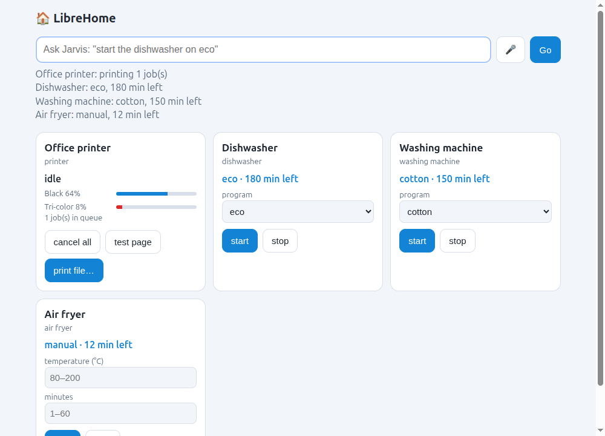

<div align="center">



# LibreHome

**The driverless home: every appliance in one free app, no vendor apps, no drivers.**

[](https://github.com/juujbyg/librehome/actions/workflows/ci.yml)
[](LICENSE)

</div>

Every appliance comes with its own app: one for the printer, one for the dishwasher, one for the washing machine, one for the air fryer. Most don't run on Linux, many need an account, and some stop working when the company loses interest.

[LibrePrint](https://github.com/juujbyg/libreprint) showed that printers don't need any of that, because they all speak an open standard (IPP Everywhere / AirPrint). **LibreHome takes the same idea to the whole home.** It talks to each appliance in the most open way it supports, and puts them all in one app that runs on Linux, Windows, macOS and Ubuntu Touch phones.

> LibreHome is early (0.1). Printers work driverlessly today. Other appliances work through bridges while their direct support is built; see [What works](#what-works).

## Features

- **One app for the whole home.** Status, start and stop for every appliance on one screen. The same app opens in a browser on your computer or phone, or in the Ubuntu Touch app.
- **Talk to it.** "start the dishwasher on eco", "air fryer 200 degrees for 12 minutes", "stop the washing machine", "status". Type it or use the microphone.
- **Driverless printing and scanning.** Finds network printers by itself, shows ink levels, warnings and the queue, prints files and cancels jobs. It scans from the printer's glass to JPEG, with a preview, from the app, by saying "scan a page", or with `librehome scan`. It uses the same IPP and eSCL code as LibrePrint, with no CUPS, SANE or drivers, so it works on Windows too.
- **Nothing to install but Python.** Standard library only. No accounts, no cloud of ours, no tracking.
- **Private by default.** The hub runs on your computer. Other devices need a pairing token.

## Get started

You need [Python 3.10+](https://www.python.org/downloads/).

```sh
git clone https://github.com/juujbyg/librehome && cd librehome
./run.sh            # Linux / macOS
run.bat             # Windows (double-click works too)
```

The app opens in your browser. It starts with simulated appliances so you can try everything, and adds the printers it finds on your network.

**On your phone**, open the *phone URL* that `run.sh` prints (`http://<computer>:8484/?token=...`) in any browser. Ubuntu Touch users can also install the app from `ubuntutouch/`, or download the `.click` from [Releases](https://github.com/juujbyg/librehome/releases).

**From the terminal** (`PYTHONPATH=src python3 -m librehome ...`, or `librehome ...` after `pip install .`): `say "start the dishwasher"`, `scan -o page.jpg`, `devices`, `config`.

## What works

| Appliance | How LibreHome reaches it | Status |
|---|---|---|
| Printers (IPP Everywhere / AirPrint) | **Direct, driverless**: IPP + mDNS | ✅ Works |
| Printers already set up on the computer, including USB | CUPS / Windows printers | ✅ Works |
| Dishwashers, washing machines, dryers, ovens, air fryers, fridges, vacuums... | [Home Assistant](https://www.home-assistant.io/) bridge, or the appliance's own web API | ✅ Works through a bridge |
| The same, **directly** | **Matter**, the open standard that now covers dishwashers, washers, dryers, ovens, fridges and vacuums | 🛠 Next |
| Scanners built into printers (eSCL / AirPrint) | **Direct, driverless**: eSCL | ✅ Works |

To connect real appliances, see [docs/ADAPTERS.md](docs/ADAPTERS.md). Tried an appliance? Please [tell us](https://github.com/juujbyg/librehome/issues/new?template=device-report.yml), whether it worked or not. Reports are collected in [docs/HARDWARE.md](docs/HARDWARE.md).

## Roadmap

1. **Matter.** Direct control of Matter appliances. Matter is to appliances what IPP is to printers: this is what makes the whole home driverless.
2. **More scanning.** Document feeder, several pages into one PDF.
3. **Direct vendor APIs. Open, documented APIs where a brand has no Matter yet (for example Home Connect for Bosch/Siemens).
4. **Install.** A Debian package and a Windows installer, so Python isn't needed.
5. **Automations.** For example: "tell me when the washing machine finishes".

## Security

Requests from other devices need the token from the config file, and the computer running the hub is trusted. Traffic is plain HTTP, so keep the hub on your home network. To use it from outside, connect through a VPN (WireGuard, Tailscale) rather than opening a port on your router.

## Contributing

Bug reports, device reports and new adapters are all welcome; see [CONTRIBUTING.md](CONTRIBUTING.md).

## License

[GPL-2.0-or-later](LICENSE), like LibrePrint.

> LibreHome isn't affiliated with, endorsed by or sponsored by any appliance maker. Brand names are trademarks of their owners and are used only to describe the devices LibreHome works with.
